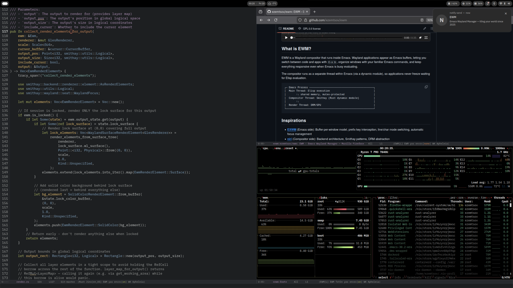

# EWM - Emacs Wayland Manager



EWM is a modern, fast Linux desktop environment based on Emacs. It is written in Rust, built on [Smithay](https://github.com/Smithay/smithay), and runs as a dynamic module inside an Emacs session. Wayland applications appear as Emacs buffers, which means graphical windows can be managed with the same commands, keybindings, and workflows as the rest of Emacs.

The ultimate goal of EWM is to let power users be bottlenecked by their own thinking, not by the tools they use. Computers should never stand in our way. EWM is built around the idea that window management, application launching, navigation, text input, and system control should be fast, deterministic, programmable, and composable.

Years ago I tried Emacs and became obsessed with how elegant and powerful the flow was. Most Emacs actions do not require visual feedback: once a command sequence is learned, it can be executed blindly through deterministic key presses. Over time this creates a huge productivity boost, with virtually no skill cap. The only missing piece was graphical windows. EWM solves that by making Wayland windows part of the Emacs environment itself.

## Approach

EWM was bootstrapped with LLM assistance. Today, coding agents are used mainly to compare EWM against [niri](https://github.com/YaLTeR/niri) and catch divergences from proven Smithay compositor patterns before they become correctness, performance, or reliability issues. This feedback loop is a major reason EWM could be built quickly while still becoming fast and reliable enough for daily use.

## Quick Start

For local testing, use the helper script:

```bash
cd compositor
./test.sh
```

The script builds EWM with screencast support, sets `EWM_MODULE_PATH`, and starts Emacs with `--fg-daemon=vt2`. Pass an init directory as the only argument when you need one, for example `./test.sh /etc/nixos/emacs`. The named daemon is intentional: plain `--fg-daemon` uses the default Emacs server socket and can conflict with an existing Emacs daemon. Connect to this session with `emacsclient --socket-name=vt2`.

Launch apps with `s-d`. See the [wiki](https://codeberg.org/ezemtsov/ewm/wiki) for full setup, configuration, and NixOS instructions.

## Current Features

- Wayland applications as regular Emacs buffers
- Emacs-native window management, focus, keybindings, and fullscreen
- Multi-monitor DRM backend with hotplug, output configuration, and fractional scaling
- Layer-shell, workspace, screen lock, idle, activation, clipboard, and drag-and-drop protocol support
- Screen sharing through xdg-desktop-portal and PipeWire
- Input methods and keyboard configuration integrated with Emacs
- External app launching through XDG desktop entries

## Known Limitations

- GPU selection is automatic (no override)
- Must run from TTY (no nested mode)

## Inspirations

- **[EXWM](https://github.com/ch11ng/exwm)** (Emacs side): Buffer-per-window model, prefix key interception, automatic focus management
- **[niri](https://github.com/YaLTeR/niri)** (Compositor side): Backend architecture, Smithay patterns, DRM abstraction

## Community

Join the Matrix room: [#ewm:matrix.org](https://matrix.to/#/#ewm:matrix.org)

## License

GPL-3.0
